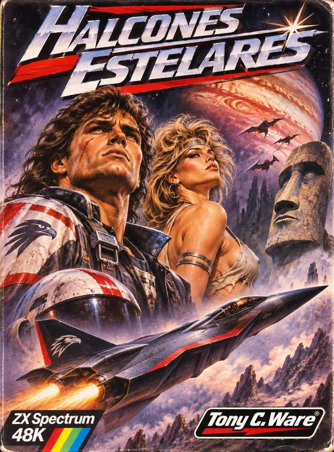

  

# HALCONES ESTELARES

**ZX Spectrum 48K · Código máquina Z80 · © 2026 Tony C. Ware**

**[DESCARGAR TAP v1.3.3](JUEGO/HALCONES_ESTELARES_1_3_3.tap)** · [Releases oficiales](https://github.com/OnRail76/Halcones-Estelares/releases) · [Código fuente Z80 v1.3.3](fuentes/1.3.3/README.md)

## 1988. El futuro

La **Fuerza Espacial Europea** envía al **ESF-01** rumbo a **Europa, luna de Júpiter**, tras la desaparición de varias sondas. En el vacío aguardan aves cósmicas cuyo propósito es **invadir, destruir y COMER**. ¿Quién las dirige? **¡Sus gritos se oirán en el Cosmos!**

## El juego

Arcade de seis oleadas por fase contra **CROW, HARPY, VULTURE y OSPREY**, antes del temible **MOAI MONOLITH**. Tres vidas, escudo, marcador y récord. Primera formación con **10 CROW**; el resto de formaciones emplean seis enemigos. Dos disparos propios simultáneos y dificultad progresiva.

**v1.3.3:** efectos beeper reorganizados en golpes cortos; **16 estrellas móviles**; retirados los fondos espaciales lejanos para reducir choques de atributos. Se conservan Júpiter y la luna del jefe. La música del título se reproduce **una vez** al entrar en la pantalla. [Historial de cambios](docs/CAMBIOS_1_3_3.md).

## Controles

| Entrada | Acción |
|---|---|
| O / P | Mover a izquierda / derecha |
| ESPACIO | Disparar e iniciar con teclado |
| A o Q | Escudo |
| H | Pausa |
| Sinclair 6 / 7 / 0 | Mover y disparar; 8/9 para escudo |
| Kempston | Iniciar desde el título con FIRE |

## Descargas

- [Release oficial v1.3.3](https://github.com/OnRail76/Halcones-Estelares/releases/tag/v1.3.3): TAP, código fuente, manual, atlas y documentación completa.
- [Fuentes de v1.3.3](fuentes/1.3.3/README.md) y [TAP original](JUEGO/HALCONES_ESTELARES_1_3_3.tap).
- [Release v1.3.2](https://github.com/OnRail76/Halcones-Estelares/releases/tag/v1.3.2): cinco **carátulas aprobadas**, oficial ESF-01 negra y PDF históricos de la edición 1.0. **No modificar las carátulas ni colocarles número de versión.**
- [Release v1.0](https://github.com/OnRail76/Halcones-Estelares/releases/tag/v1.0): primera edición y documentación visual original.

## Documentación ilustrada actual (v1.3.3)

- [Manual de instrucciones completo (PDF, 11 páginas)](docs/01_MANUAL_DE_INSTRUCCIONES_HALCONES_ESTELARES_v1.3.3.pdf), con la carátula en la primera página.
- [Atlas visual y memoria técnica (PDF, 23 páginas)](docs/02_ATLAS_VISUAL_Y_MEMORIA_TECNICA_HALCONES_ESTELARES_v1.3.3.pdf), con el anexo **«Arcade Aviar»**.
- [Paquete documental completo (ZIP)](https://github.com/OnRail76/Halcones-Estelares/releases/download/v1.3.3/HALCONES_ESTELARES_1_3_3_DOCUMENTACION_COMPLETA.zip), con capturas y sprites reales.

Esta documentación corresponde a la **edición v1.3.3**. Los documentos ilustrados de la edición 1.0 siguen disponibles en las releases históricas v1.0/v1.3.2, pero ya no son la referencia vigente.

## Compilación e integridad

`python3 fuentes/1.3.3/build.py` reconstruye el TAP **idéntico byte a byte**. Las ocho secciones de la cinta tienen paridad XOR correcta; **24 pruebas vigentes superadas**. Tres regresiones viejas con rutas de desarrollo absolutas están archivadas, fuera de la suite actual; no se afirma verificación en hardware físico.

**SHA-256 de v1.3.3:** `0db551592d01900287f0dad4754b840589075fb50ae3e7405ea66dbf21266ddf`

## Licencias y créditos

**Autor y dirección creativa: Tony C. Ware.** Asistencia IA: OpenAI GPT y Anthropic Claude. Código y herramientas: MIT asistida por IA ([inglés](LICENSE), [castellano](LICENSE_ES.md)). Gráficos, sprites, logos y carátulas: [derechos reservados](LICENCIA_GRAFICOS.md).

**¡Sus gritos se oirán en el Cosmos!**
