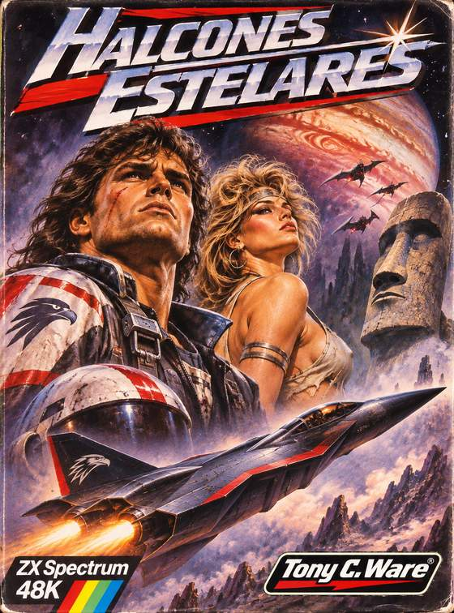
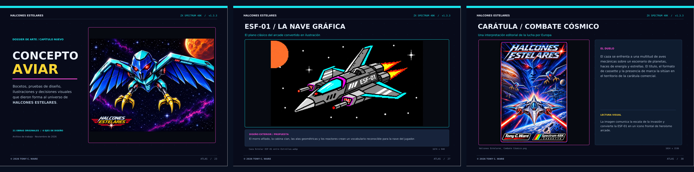

# HALCONES ESTELARES

**ZX Spectrum 48K · Ensamblador Z80 · © 2026 Tony C. Ware**

**[DESCARGAR EDICIÓN DEFINITIVA v1.4](https://github.com/OnRail76/Halcones-Estelares/releases/tag/v1.4)** · [Jugar en TAP](JUEGO/HALCONES_ESTELARES_1_4.tap) · [Fuentes Z80](fuentes/1.4/README.md) · [Libro completo](docs/HALCONES_ESTELARES_1_4_LIBRO_DEL_JUEGO.pdf)

## 1988. El futuro

La Fuerza Espacial Europea envía el caza **ESF-01** rumbo a **Europa, luna de Júpiter**, después de perder varias sondas. Aves cósmicas amenazan con invadir, destruir y COMER. Detrás de ellas aguarda el **MOAI MONOLITH**.

**¡SUS GRITOS SE OIRÁN EN EL COSMOS!**

## Edición definitiva 1.4

- Seis oleadas y un MOAI por fase, con dificultad creciente.
- Director de oleadas: seis coreografías (Space Invaders, Galaxian, Pleiads, Phoenix, Moon Cresta y Galaga) y combinaciones de CROW, HARPY, VULTURE y OSPREY.
- Primera oleada de diez CROW; oleadas posteriores con seis aves.
- Hasta seis balas enemigas, con trayectorias diagonales; el MOAI dispone de cinco ataques.
- 25 actualizaciones por segundo, **estrellas fijas**, compositor optimizado y sonidos para beeper.
- Tres vidas, escudo recargable, récord y vida extra cada 1.000 puntos si tienes menos de tres.

## Controles

| Entrada | Acción |
| --- | --- |
| O / P | Izquierda / derecha |
| ESPACIO | Disparo por pulsación; iniciar con teclado |
| A o Q | Escudo |
| H | Pausar y reanudar |
| Sinclair | 6 / 7 mover, 0 disparar, 8 / 9 escudo |
| Kempston | Iniciar pulsando FIRE; izquierda/derecha, FIRE disparar, arriba/abajo escudo |

## Solo una edición documental

El **[Libro del juego 1.4 (PDF de 50 páginas)](docs/HALCONES_ESTELARES_1_4_LIBRO_DEL_JUEGO.pdf)** sustituye al manual, atlas, memoria técnica y volumen conceptual separados. Contiene capturas **reales** del Spectrum, sprites extraídos del TAP, el plano técnico, arte conceptual, carátulas, programas utilizados y créditos. No se distribuyen documentos antiguos en paralelo.

Las **carátulas aprobadas**, incluidas la oficial y las cuatro alternativas, se conservan sin alteraciones en los archivos de la release. La selección se documenta en [Carátulas confirmadas](docs/CARATULAS_CONFIRMADAS.md). Los originales de `media/` se mantienen.

## Compilación y verificación

`python3 fuentes/1.4/build.py` reconstruye el TAP byte a byte. El archivo de referencia y la recompilación se han comparado directamente.

**SHA-256:** `7c595b9d7f61cba9145ce6a16e883ca0653750ac52a3cc2845066045967d1cad`

## Derechos

**© 2026 Tony C. Ware.** Código y herramientas: [MIT](LICENSE) ([castellano](LICENSE_ES.md)). Gráficos, carátulas, sprites, logos e ilustraciones: [derechos reservados](LICENCIA_GRAFICOS.md); véase también [DERECHOS_GRAFICOS.md](DERECHOS_GRAFICOS.md).
